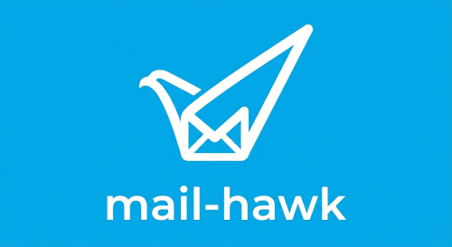
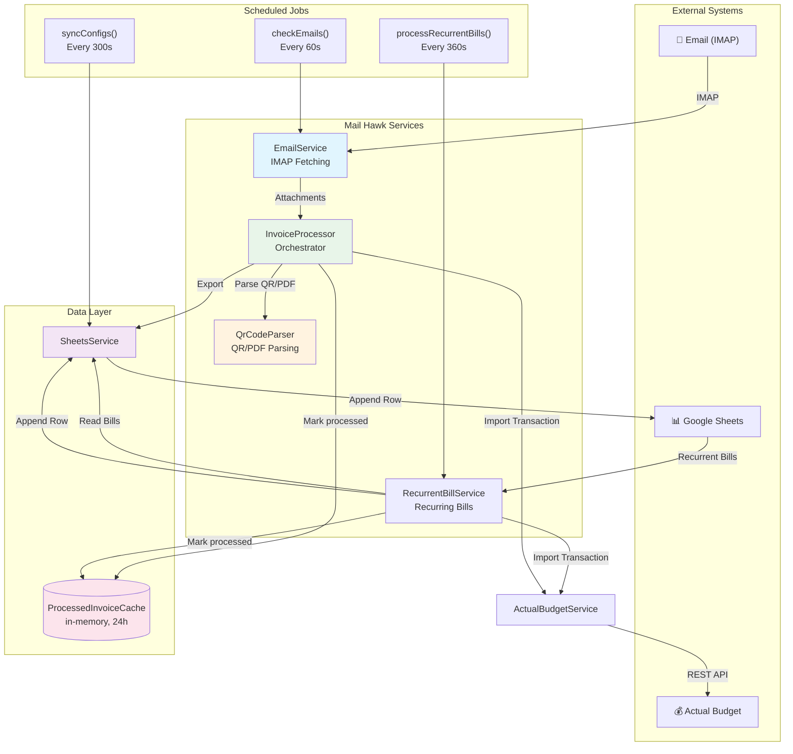

# Mail Hawk

[](https://github.com/amfalmeida/mail-hawk/actions/workflows/ci.yaml)
[](https://openjdk.org/projects/jdk/21/)
[](https://quarkus.io/)
[](LICENSE)

<p align="center">
  
</p>

Monitor email for invoice attachments, parse QR codes and store data in Google Sheets + Actual Budget.

**Java 21 + Quarkus Implementation** - Optimized for performance and memory efficiency.

## Features

- **Email Monitoring**: Monitors email via IMAP for invoice attachments
- **QR Code Parsing**: Parses QR codes from PDF and image files (Portuguese ATCUD format)
- **Recurrent Bills**: Automatically creates invoices from recurring bills configured in Google Sheets
- **Google Sheets Integration**: Stores invoice data in Google Spreadsheet
- **Actual Budget Integration**: Automatically imports transactions to Actual Budget
- **No Database Needed**: Processed invoices are tracked in in-memory caches; Google Sheets is the source of truth
- **Home Assistant Add-on**: Runs as a Home Assistant add-on with a health-check watchdog
- **Performance Optimized**: Low memory footprint with Quarkus native compilation support
- **Modern Java**: Uses Java 21 features (records, pattern matching)

## Tech Stack

- **Java 21** - Latest LTS with modern features
- **Quarkus 3.34.x** - Supersonic subatomic Java framework
- **Lombok** - Reduce boilerplate code
- **Jakarta Mail** - IMAP email client
- **ZXing** - QR code processing
- **Apache PDFBox** - PDF rendering
- **Google Sheets API** - Spreadsheet integration
- **Actual Budget HTTP API** - Budget integration
- **Caffeine** - In-memory caches

## Architecture



## Quick Start

### Prerequisites

- Java 21+ (JDK 21 or higher)
- Docker (for containerized deployment)

### Build

```bash
# Using Maven wrapper
./mvnw clean package

# Run tests
./mvnw test

# Run in development mode
./mvnw quarkus:dev
```

### Run Locally

```bash
# Set environment variables
export MAIL_HOST="imap.gmail.com"
export MAIL_PORT="993"
export MAIL_USERNAME="your-email@gmail.com"
export MAIL_PASSWORD="your-app-password"
export SHEETS_ID="your-spreadsheet-id"
export SHEETS_ENCODED_CREDENTIALS="base64-encoded-credentials"

# Run with Maven wrapper
./mvnw quarkus:dev
```

## Makefile Commands

```bash
make help              # Show all available commands

# Development
make install           # Install Java dependencies
make build             # Build the project
make run               # Run in development mode
make test              # Run tests
make clean             # Clean build artifacts

# Docker
make docker-build      # Build Docker image
make docker-up         # Run Docker container
make docker-logs       # View Docker logs
make docker-down       # Stop Docker container
make docker-clean      # Remove Docker image and volumes

# Home Assistant Add-on
make addon-build       # Build add-on image
make addon-run         # Build and run add-on
make addon-logs        # View add-on logs

# Setup
make setup             # Create .env from .env.example
```

## Configuration

### Environment Variables

#### Mail Configuration

| Variable | Description | Default |
|----------|-------------|---------|
| `MAIL_HOST` | IMAP server host | `imap.gmail.com` |
| `MAIL_PORT` | IMAP server port | `993` |
| `MAIL_USERNAME` | Email username | - |
| `MAIL_PASSWORD` | Email password or app password | - |
| `MAIL_FOLDER` | Folder to watch | `INBOX` |
| `MAIL_DAYS_OLDER` | Days to look back | `30` |
| `MAIL_SUBJECT_TERMS` | Comma-separated subject search terms | `fatura,factura,extracto,recibo` |
| `MAIL_ONLY_ATTACHMENTS` | Only process emails with attachments | `true` |
| `MAIL_MAX_EMAILS` | Max emails per check (0 = unlimited) | `0` |
| `MAIL_MIN_ATTACHMENT_SIZE` | Min message size in bytes (0 = disabled) | `0` |
| `MAIL_MESSAGE_CACHE_EXPIRE_SECONDS` | Processed message cache expiration in seconds | `1800` |

#### Google Sheets Configuration

| Variable | Description | Default |
|----------|-------------|---------|
| `SHEETS_ID` | Google Sheets ID | - |
| `SHEETS_SHEET_NAME` | Sheet name for invoices | `values` |
| `SHEETS_CONFIG_SHEET` | Config sheet name | `config` |
| `SHEETS_RECURRENT_SHEET` | Recurrent bills sheet name | `recurrent` |
| `SHEETS_ENCODED_CREDENTIALS` | Base64 encoded service account | - |

#### Application Configuration

| Variable | Description | Default |
|----------|-------------|---------|
| `APP_CHECK_INTERVAL` | Email check interval in seconds | `60` |
| `APP_CONFIG_SYNC_INTERVAL` | Config sync interval in seconds | `300` |
| `APP_DEFAULT_INVOICE_TYPE` | Default invoice type | `other` |
| `APP_RECURRENT_CHECK_INTERVAL` | Recurrent bills check interval in seconds | `360` |
| `APP_PROCESSED_INVOICE_CACHE_HOURS` | How long processed invoices are remembered in memory | `24` |
| `APP_PROCESSED_INVOICE_CACHE_SIZE` | Max processed invoices kept in memory | `10000` |
| `APP_CONFIG_CACHE_HOURS` | How long invoice-type configs (by NIF/email) are cached in memory | `1` |
| `APP_LAST_CHECKED_CACHE_HOURS` | How long the last email check time is remembered; after that, `MAIL_DAYS_OLDER` is used | `24` |
| `APP_API_ENABLED` | Enable the invoice API (`POST /api/invoices`) | `false` |
| `APP_API_KEY` | Key callers must send in the `X-API-Key` header. Required when the API is enabled | - |
| `APP_API_PORT` | Port of the invoice API. Health checks always stay on `8080` | `8081` |

#### Actual Budget Configuration

| Variable | Description | Default |
|----------|-------------|---------|
| `ACTUAL_ENABLED` | Enable Actual Budget integration | `false` |
| `ACTUAL_URL` | Actual Budget HTTP API URL | - |
| `ACTUAL_API_KEY` | API key for authentication | - |
| `ACTUAL_BUDGET_SYNC_ID` | Budget sync ID | - |
| `ACTUAL_ACCOUNT_ID` | Account ID for transactions | - |

### Invoice API

`POST /api/invoices` stores invoices that don't arrive by email. It takes the invoice date, the entity name and the
raw AT QR code string. It parses the QR string the same way the email check does, then runs the same steps:
invoice-type resolution, Sheets, Actual Budget and duplicate checks.

To enable it, set `APP_API_ENABLED=true` and an `APP_API_KEY` (add-on options `api_enabled` and `api_key`, see
[API Settings](#api-settings)). Every request must send the key in the `X-API-Key` header. The API answers 403
while it is disabled or no key is set.

```bash
curl -H "X-API-Key: $APP_API_KEY" -H "Content-Type: application/json" \
  http://localhost:8081/api/invoices -d '{
    "date": "2026-10-01",
    "entityName": "Águas do Porto",
    "raw": "A:123456789*B:999999990*C:PT*D:FT*E:N*F:20261001*G:FT 2026/123*H:ABCD1234-123*I1:PT*I7:10.00*I8:2.30*N:2.30*O:12.30*Q:abcd*R:1234"
  }'
```

| Field | Description | Required |
|-------|-------------|----------|
| `date` | Invoice date (`yyyy-MM-dd`). Stored in the date column, and used as the invoice date if the QR code has no `F` field | yes |
| `entityName` | Entity name. Stored in the entity column and used as the Actual Budget payee. When empty, the name from the `config` tab is used | no |
| `raw` | AT QR code string. Must contain at least `A` (issuer NIF) and `G` (invoice ID) | yes |

The invoice type still comes from the issuer NIF in the `config` tab, falling back to `APP_DEFAULT_INVOICE_TYPE`.
`raw` is the duplicate-check key, the same as for email invoices.

The response has `invoiceId`, `issuerTin`, `total`, `invoiceType`, `status` and `message`.

| HTTP status | `status` | Meaning |
|-------------|----------|---------|
| `201` | `APPENDED` | Added to Sheets (and imported into Actual Budget) |
| `200` | `ALREADY_EXISTS` / `ALREADY_PROCESSED` | Already in Sheets / already processed recently |
| `400` | - | Missing `date` or `raw`, or `raw` is not a valid QR code |
| `401` / `403` | - | Wrong or missing key / API disabled or no key configured |
| `502` | `ERROR` | Google Sheets write failed; nothing was imported, so it is safe to retry |

### Docker

```bash
# Build
make docker-build

# Run
make docker-up
```

### Full Stack with Docker Compose

The `docker-compose.yml` includes all required services:

1. **mail-hawk** - Invoice processing service (health on port 8080, invoice API on port 8081)
2. **actual-http-api** - Actual Budget HTTP API (port 5007)

```bash
# Start all services
docker-compose up -d

# View logs
docker-compose logs -f mail-hawk

# Stop all services
docker-compose down
```

To also run **Actual Budget** server, add this to your `docker-compose.yml`:

```yaml
services:
  actual-budget:
    image: actualbudget/actual-server:latest
    container_name: actual-budget
    restart: unless-stopped
    ports:
      - "5006:5006"
    volumes:
      - actual-budget-data:/data
    networks:
      - mail-hawk-network
```

**Service URLs:**
- Mail Hawk health: http://localhost:8080/q/health
- Mail Hawk invoice API: http://localhost:8081/api/invoices
- Actual Budget HTTP API: http://localhost:5007
- Actual Budget (if running): http://localhost:5006

## Actual Budget Integration

Mail Hawk can automatically import invoice transactions into [Actual Budget](https://actualbudget.org/).

### Prerequisites

1. **Actual Budget HTTP API** - You need to run the Actual Budget HTTP API alongside your Actual Budget instance. See [ha-actual-http-api](https://github.com/amfalmeida/ha-actual-http-api) for a Home Assistant add-on that provides this API.

2. **API Key** - Generate an API key from the Actual Budget HTTP API settings.

3. **Budget and Account IDs** - Get the sync ID and account ID from your Actual Budget instance.

### How It Works

When invoices are processed:
1. Invoice data is extracted from QR codes
2. Transaction is created with:
   - **Account**: Configured account ID
   - **Date**: Invoice date from QR code
   - **Amount**: Total amount (negative for expenses)
   - **Payee**: Invoice type/entity name
   - **Notes**: Invoice filename
   - **Imported ID**: ATCUD from QR code (for deduplication)
   - **Cleared**: true

### Configuration

```bash
# Enable Actual Budget integration
ACTUAL_ENABLED=true

# HTTP API URL (from ha-actual-http-api or standalone)
ACTUAL_URL=http://your-server:5007

# API key
ACTUAL_API_KEY=your-api-key

# Budget sync ID (from Actual Budget)
ACTUAL_BUDGET_SYNC_ID=your-budget-sync-id

# Account ID for transactions
ACTUAL_ACCOUNT_ID=your-account-id
```

### Related Projects

- [ha-actual-http-api](https://github.com/amfalmeida/ha-actual-http-api) - Home Assistant add-on providing the HTTP API for Actual Budget

## Home Assistant Add-on

### Installation

1. Add this repository to your Home Assistant supervisor
2. Install the "Mail Hawk" add-on
3. Configure via the add-on UI
4. Start the add-on

### Configuration

#### Mail Settings

| Option | Description | Default |
|--------|-------------|---------|
| `mail_imap_host` | IMAP server host | `imap.gmail.com` |
| `mail_imap_port` | IMAP server port | `993` |
| `mail_imap_username` | Email address | - |
| `mail_imap_password` | App password | - |
| `mail_imap_folder` | Email folder to monitor | `INBOX` |
| `mail_imap_days_older` | Days to look back | `30` |
| `mail_subject_terms` | Comma-separated subject filter terms | `fatura,factura,extracto,recibo` |
| `mail_listener_only_attachments` | Only process emails with attachments | `true` |
| `mail_min_attachment_size` | Min message size in bytes (0 = disabled) | `0` |
| `mail_message_cache_expire_seconds` | Processed message cache expiration in seconds | `1800` |
| `pdf_passwords` | PDF passwords (comma-separated) | - |

#### Google Sheets Settings

| Option | Description | Default |
|--------|-------------|---------|
| `spreadsheet_id` | Google Sheets ID | - |
| `spreadsheet_sheet` | Invoice sheet name | `values` |
| `spreadsheet_sheet_db` | Config sheet name | `config` |
| `spreadsheet_sheet_recurrent` | Recurrent bills sheet name | `recurrent` |
| `google_auth_encoded` | Base64-encoded service account JSON | - |

#### Application Settings

| Option | Description | Default |
|--------|-------------|---------|
| `invoice_type_default` | Default invoice type | `other` |
| `check_interval` | Email check interval in seconds | `60` |
| `config_sync_interval` | Config sync interval in seconds | `300` |
| `recurrent_check_interval` | Recurrent bills check interval in seconds | `360` |
| `processed_invoice_cache_hours` | How long processed invoices are remembered in memory | `24` |
| `last_checked_cache_hours` | How long the last email check time is remembered | `24` |
| `config_cache_hours` | How long invoice-type configs are cached | `1` |

#### Actual Budget Settings

| Option | Description | Default |
|--------|-------------|---------|
| `actual_enabled` | Enable Actual Budget integration | `false` |
| `actual_url` | Actual Budget HTTP API URL | - |
| `actual_api_key` | API key for authentication | - |
| `actual_budget_sync_id` | Budget sync ID | - |
| `actual_account_id` | Account ID for transactions | - |

#### API Settings

| Option | Description | Default |
|--------|-------------|---------|
| `api_enabled` | Enable the invoice API (`POST /api/invoices`) | `false` |
| `api_key` | Key callers must send in the `X-API-Key` header. Required when the API is enabled | - |
| `api_port` | Port of the invoice API. `8080` is reserved for health checks | `8081` |

To turn on the API in Home Assistant:

1. Generate a key, for example with `openssl rand -hex 32`.
2. In **Settings → Add-ons → Mail Hawk → Configuration**, switch on `api_enabled`, paste the key into `api_key` and,
   if 8081 is taken on your host, change `api_port`.
3. Save and restart the add-on.

The add-on uses the host network, so the API is at `http://<home-assistant-host>:<api_port>/api/invoices`. Health
checks stay on port 8080 (`/q/health/*`), where the add-on watchdog expects them. For example,
to call it from a Home Assistant automation, keep the key in `secrets.yaml` and add a `rest_command`:

```yaml
# secrets.yaml
mail_hawk_api_key: "X-API-Key value"

# configuration.yaml
rest_command:
  mail_hawk_invoice:
    url: "http://localhost:8081/api/invoices"
    method: POST
    headers:
      X-API-Key: !secret mail_hawk_api_key
    content_type: "application/json"
    payload: '{"date": "{{ date }}", "entityName": "{{ entity_name }}", "raw": "{{ raw }}"}'
```

### Gmail Setup

1. Enable 2-Factor Authentication on your Google account
2. Go to Account Settings > Security > App Passwords
3. Generate a new app password
4. Use this password in `mail_imap_password`

### Google Sheets Setup

1. Create a Google Cloud Project
2. Enable Google Sheets API
3. Create a Service Account
4. Download the JSON credentials
5. Base64 encode: `base64 -w0 credentials.json` (Linux) or `base64 -i credentials.json` (macOS)
6. Paste the result in `google_auth_encoded`
7. Share your spreadsheet with the service account email (Editor access)

## Google Sheets Setup

1. Create a Google Cloud Project
2. Enable the Google Sheets API
3. Create service account credentials
4. Share your spreadsheet with the service account email (as Editor)
5. Base64 encode the credentials:

```bash
# Linux
base64 -w0 credentials.json

# macOS
base64 -i credentials.json
```

Set the result as `SHEETS_ENCODED_CREDENTIALS`.

### Google Sheets Structure

The application uses three sheets in your Google Spreadsheet:

#### 1. Invoices Sheet (default: "values")

Stores processed invoice data from email attachments.

| Column | Field | Description |
|--------|-------|-------------|
| A | Type | Invoice type (from config) |
| B | To Email | Recipient email address |
| C | From Email | Sender email address |
| D | Entity | Entity name (from config) |
| E | Invoice ID | Invoice number from QR code |
| F | Issuer NIF | Issuer tax identification number |
| G | Customer NIF | Customer tax identification number |
| H | Invoice Date | Date from QR code (YYYY-MM-DD) |
| I | Invoice Total | Total amount |
| J | Country | Customer country code |
| K | Invoice Type | Type code from QR code |
| L | Total Non Taxable | Non-taxable amount |
| M | Stamp Duty | Stamp duty amount |
| N | Total Taxes | Sum of all taxes |
| O | Withholding Tax | Withholding tax amount |
| P | ATCUD | Unique document identifier |
| Q | Tax Country Region | Tax region code |
| R | Basics Exempt Taxes | Exempt tax base |
| S | Basics Reduced Rate | Reduced rate base |
| T | Total Taxes Reduced | Reduced rate tax amount |
| U | Basics Intermediate Rate | Intermediate rate base |
| V | Total Taxes Intermediate | Intermediate rate tax amount |
| W | Basics Standard Rate | Standard rate base |
| X | Total Taxes Standard | Standard rate tax amount |
| Y | Hash | Document hash |
| Z | Certificate Number | Certificate number |
| AA | Other Information | Additional info |
| AB | Month | Month extracted from date |
| AC | Year | Year extracted from date |
| AD | Raw QR | Raw QR code content |
| AE | Filename | PDF attachment filename |
| AF | ID | Internal invoice ID |
| AG | Date | Processing date |
| AH | Subject | Email subject |
| AI | Processed At | Processing timestamp |

#### 2. Config Sheet (default: "config")

Maps email addresses/NIFs to entity information for invoice categorization.

| Column | Field | Description |
|--------|-------|-------------|
| A | Type | Invoice type (e.g., "electricity", "water", "internet") |
| B | From Email | Sender email address to match |
| C | Name | Entity display name |
| D | NIF | Tax identification number |

#### 3. Recurrent Sheet (default: "recurrent")

Defines recurring bills that are automatically processed on their payment day.

| Column | Field | Description |
|--------|-------|-------------|
| A | Type | Invoice type |
| B | Local | Local identifier |
| C | Entity Email | Email address for the entity |
| D | Entity Name | Display name |
| E | NIF | Entity tax identification number |
| F | Customer NIF | Customer tax identification number |
| G | Value | Invoice amount |
| H | Tax | Tax amount (ignored in processing) |
| I | Payment Day | Day of month to create invoice (1-31) |
| J | Until | End date (optional, empty = forever) |
| K | Comments | Additional notes |

**Processing behavior:**
- On the configured payment day, an invoice is automatically created
- Invoice ID format: `REC-{entityName}-{YYYY-MM}`
- Added to the invoices sheet; only if that didn't fail is it imported into Actual Budget and marked as processed,
  so a failed Sheets write is retried on the next run
- Actual Budget deduplicates on `imported_id` (the ATCUD, or the raw QR string when the ATCUD is missing or `0`)

## Project Structure

```
mail-hawk/
├── pom.xml                    # Maven build config
├── Makefile                   # Build commands
├── Dockerfile                 # Docker image
├── docker-compose.yml         # Docker compose
├── config.yaml                # Home Assistant add-on config
├── repository.yaml            # HA repository config
├── run.sh                     # Startup script (maps HA options to env vars)
├── src/main/java/com/amfalmeida/mailhawk/
│   ├── client/                # REST client (Actual Budget) + dto/
│   ├── config/                # Configuration interfaces
│   ├── email/                 # IMAP access and email pipeline
│   │   ├── EmailClient.java         # IMAP connection, search, attachment extraction
│   │   ├── EmailProcessor.java      # Search → dedupe → extract → callbacks
│   │   └── model/                   # Invoice, InvoiceContent, InvoiceType, ...
│   ├── service/               # Business services
│   │   ├── EmailService.java         # Scheduled email check
│   │   ├── InvoiceProcessor.java     # Invoice processing pipeline
│   │   ├── RecurrentBillService.java # Scheduled recurrent bills
│   │   ├── SheetsService.java        # Google Sheets integration
│   │   ├── ProcessedInvoiceCache.java # In-memory record of processed invoices
│   │   ├── ActualBudgetService.java  # Actual Budget integration
│   │   └── QrCodeParser.java         # QR code parsing
│   └── health/                # Liveness (scheduler) and readiness (IMAP) checks
└── src/main/resources/
    └── application.properties
```

## License

MIT